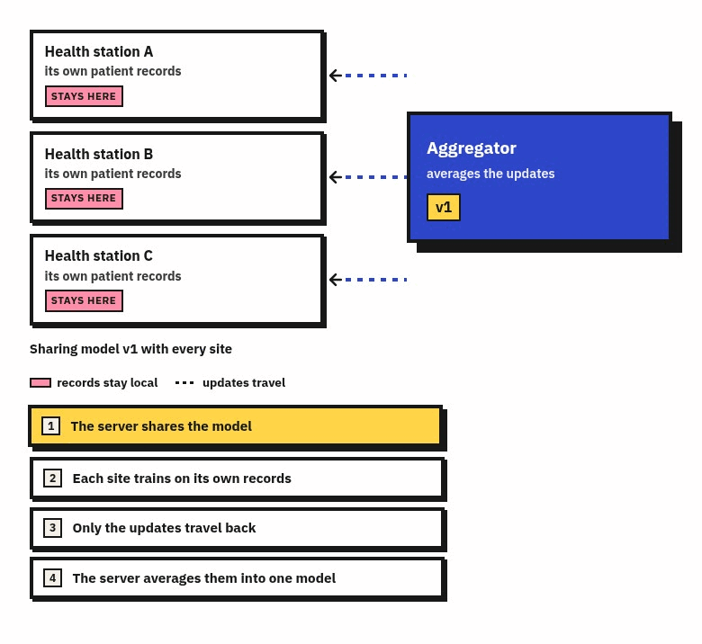

# Evaluating Inclusion-Aware Client Selection for Federated Learning under Intermittent Connectivity

**A Simulation Study Calibrated to Iligan City Barangay Health Facilities**

CSC198 · Group Beira, Jagonia, Ybanez

---

Federated learning lets health facilities train one shared model without their records ever leaving the clinic. Each site trains on its own data, and only the resulting model weights travel. The dividend is architectural rather than incidental: fewer copies of patient data exist, and facility-level separation survives contact with the design. The promise is well established. What it costs in a place like Iligan is not.

The one part of the argument that is easier to operate than to describe. Four phases, one round: the server shares the model, each station trains on its own records, only weights come back, and the aggregator averages them into the next version.

*Three health stations keep their own records; only model updates cross to the aggregator. Click to step through one round.*

Client selection under intermittent availability is already an active line of work. Adaptive sampling reacts to which clients happen to be reachable, resource-aware selection prefers the ones that finish a round soonest, and fair-sampling strategies raise the probability of clients that keep getting passed over. What that literature cannot tell the Iligan City health office is what any of these policies would cost *here*, because the parameters that decide the answer are local. The city has forty-four barangays; this study does not attempt all of them, and starts with three facility nodes. Most facilities hold only a few hundred records, so a station that has never recorded a surge has almost nothing to learn from. Links are uneven across the city and change with weather, staffing, and power; a round cannot complete until its slowest selected facility answers, so whichever station is having a bad week sets the pace for everyone. And the records themselves live in stock cards and iClinicSys, not in a research warehouse.

This study therefore does not propose a new selection algorithm. It takes the policy families that already exist, instantiates them under Iligan's constraints, and measures the two things the general literature does not report at this scale: how long each takes to reach a usable model, and what holding every facility above a participation floor costs in time. The output is a starting protocol the city health office could adopt and extend, with its price stated rather than implied — together with a calibrated parameter set that outlives the study, so the comparison can be re-run as more facilities come online.
